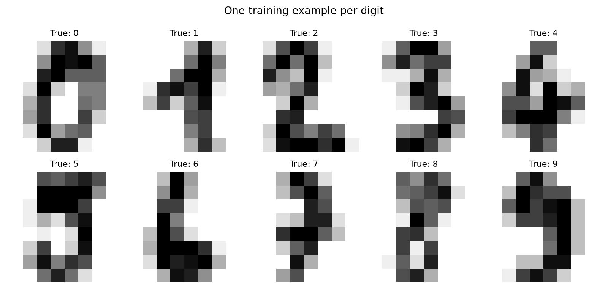

# Handwritten Digit Classifier

A small Python project that demonstrates the complete supervised machine-learning
workflow: load labeled data, separate training and test examples, train a model,
compare it with a simple baseline, and inspect its mistakes.

The task is to identify digits from 0 through 9 in preprocessed 8x8 images. The
implementation uses **logistic regression**, a classification model, with
training-only feature scaling. It runs on a CPU using scikit-learn and requires
no API credentials or external dataset download after installing dependencies.



## Results

Executed on October 4, 2026, using Python 3.12.10 and the pinned dependencies.
The fixed stratified split contains 1,437 training and 360 test examples.

| Model | Correct / test examples | Accuracy | Macro-F1 |
| --- | ---: | ---: | ---: |
| Majority-class baseline | 36 / 360 | 10.00% | 0.0182 |
| Logistic regression | 350 / 360 | **97.22%** | **0.9719** |

Accuracy measures the proportion of correct predictions. Macro-F1 gives each
digit equal weight when averaging its precision/recall-based F1 score. The
baseline always predicts the most common label in the training set.

These are measured results for this split, not an accuracy target or a claim
about other datasets. No model settings were selected using the test results.


Rows are true digits; columns are predicted digits. Six of the ten mistakes
were confusions between 1 and 8. All ten errors are shown in the
[misclassified examples](reports/misclassified_examples.png).
The [generated report](reports/summary.md) contains per-digit scores.

## Run it

Use Python **3.12** to match the verified environment. Start in a new terminal.

### Windows PowerShell

```powershell
git clone https://github.com/tristan-hooper/handwritten-digit-classifier.git
cd handwritten-digit-classifier
python -m venv .venv
.\.venv\Scripts\python.exe -m pip install -r requirements.txt
.\.venv\Scripts\python.exe train_evaluate.py
.\.venv\Scripts\python.exe -m pytest -q
```

### Linux or macOS

```bash
git clone https://github.com/tristan-hooper/handwritten-digit-classifier.git
cd handwritten-digit-classifier
python3.12 -m venv .venv
.venv/bin/python -m pip install -r requirements.txt
.venv/bin/python train_evaluate.py
.venv/bin/python -m pytest -q
```

To preserve the committed reports while experimenting, pass a different output
directory: `python train_evaluate.py --output-dir tmp-results` with your virtual
environment's Python. Running without that option replaces the files in `reports/`.

## How it works

1. Load scikit-learn's built-in `load_digits()` dataset: 1,797 examples, each with
   64 numeric pixel features and a known digit label.
2. Split row indices 80/20 with stratification and seed 42. Stratification keeps
   the proportions of the ten digits approximately consistent between subsets.
3. Fit a `StandardScaler` and `LogisticRegression` together in a pipeline, using
   only training rows. Fit the majority-class baseline on the same training labels.
4. Evaluate both models on exactly the same held-out rows. The fixed model uses
   `C=1.0`, `solver="lbfgs"`, and `max_iter=1000`; convergence warnings fail the run.
5. Export predictions, metrics, split indices, and figures for inspection.

## Skills demonstrated

- Python functions, command-line arguments, NumPy arrays, and file exports.
- Features versus labels, supervised learning, and multiclass classification.
- Reproducible splitting and prevention of preprocessing leakage.
- Baseline comparison, accuracy, precision, recall, F1, and confusion matrices.
- Error analysis and verification of reported results against exported predictions.

The six tests check split coverage and separation, class proportions, reproducible
splits, a hand-calculated metric example, source-label and report consistency,
readable figures, and repeatability of the complete experiment. Multiple related
properties are checked within individual tests.

## Files and reproducibility

- `train_evaluate.py`: the complete training and evaluation script.
- `tests/test_experiment.py`: verification checks.
- `requirements.txt`: the exact installed dependency snapshot, including test tools.
- `reports/metrics.json`: unrounded scores, settings, dataset fingerprint, and versions.
- `reports/predictions.csv`: each test example's source index, true label, model
  prediction, and baseline prediction.
- `reports/split_indices.json`: exact training/test membership.
- `reports/summary.md` and PNG files: readable results and visualizations.

Seed 42 fixes the split. Repeated runs were checked in the verified local
environment. Different numerical libraries or platforms can produce small
differences; bit-for-bit cross-platform reproducibility is not promised.

## Scope and attribution

This is a fundamentals project. It evaluates preprocessed examples from one
dataset; it does not establish performance on new writers or document photos.
The same training/evaluation practices can support other applied AI projects,
including healthcare work, but this project contains no clinical data or clinical
validation.

The bundled dataset is the original UCI dataset's test portion. This project
creates a new split within that portion. See [NOTICE.md](NOTICE.md) for the
dataset citation, CC BY 4.0 attribution, and learning references. Original project
code is available under the [MIT license](LICENSE).
