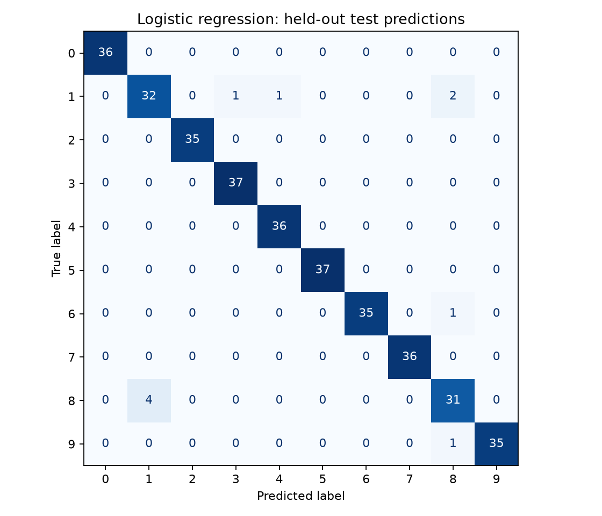
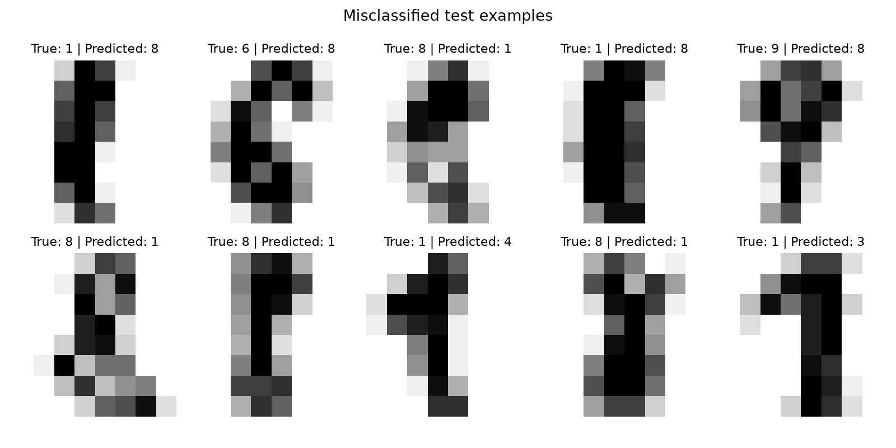

# Evaluation results

Generated by `python train_evaluate.py` from actual held-out predictions.

Split: 1437 training / 360 test examples.
Seed: 42. Stratified 80/20 split. Fixed settings; no hyperparameter search.

| Model | Correct / test examples | Accuracy | Macro-F1 |
| --- | ---: | ---: | ---: |
| majority_baseline | 36 / 360 | 10.00% | 0.0182 |
| logistic_regression | 350 / 360 | 97.22% | 0.9719 |

Accuracy is the fraction of correct predictions. Macro-F1 averages each
digit's F1 equally. The confusion matrix uses true labels as rows and
predicted labels as columns. Undefined per-class scores are reported as zero.

## Per-digit results for logistic regression

| Digit | Precision | Recall | F1 | Test examples |
| --- | ---: | ---: | ---: | ---: |
| 0 | 1.0000 | 1.0000 | 1.0000 | 36 |
| 1 | 0.8889 | 0.8889 | 0.8889 | 36 |
| 2 | 1.0000 | 1.0000 | 1.0000 | 35 |
| 3 | 0.9737 | 1.0000 | 0.9867 | 37 |
| 4 | 0.9730 | 1.0000 | 0.9863 | 36 |
| 5 | 1.0000 | 1.0000 | 1.0000 | 37 |
| 6 | 1.0000 | 0.9722 | 0.9859 | 36 |
| 7 | 1.0000 | 1.0000 | 1.0000 | 36 |
| 8 | 0.8857 | 0.8857 | 0.8857 | 35 |
| 9 | 1.0000 | 0.9722 | 0.9859 | 36 |

The error plot shows up to the first 15 errors in the fixed test order,
rather than handpicked successes. Exact predictions and source row indices
are in `predictions.csv`; split membership is in `split_indices.json`.

This evaluates a random split of the bundled digits dataset. It does not
establish performance on new writers, photographed documents, or clinical data.
